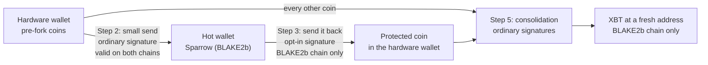

# Replay protection for a hardware wallet that can't sign the opt-in

If you held bitcoin before block 961,640, every coin you held then exists on two chains: Bitcoin (SHA256d) & the BLAKE2b chain (XBT). Until you split them, a normal send of your BTC also moves the matching XBT, to the same address, in the same transaction.

That isn't a theoretical risk. On 15 October 2026, 116 of 120 non-coinbase transactions sampled from BLAKE2b blocks 977,337, 977,407 & 977,436 were copies of transactions confirmed on the SHA256d chain. The median copy confirmed on the BLAKE2b chain 6 minutes *before* the original confirmed on SHA256d, so the copies are spreading through the mempool alongside the originals, not being rebroadcast later.

This guide splits a whole hardware wallet without the hardware wallet ever signing anything unusual, & without moving the stack to another device.

## Who this is for

You need this method if your signer can't produce the opt-in signature hash (SIGHASH_UNIFIED, [Knots PR #357](https://github.com/bitcoinknots/bitcoin/pull/357)). Stock firmware for Jade, Ledger, BitBox02, Trezor & Coldcard refuses it, & stock SeedSigner skips the input instead of signing it.

Unofficial firmware forks from [privkeyio](https://github.com/privkeyio) do sign it: Trezor `unified-sighash.2`, Coldcard `v5.6.3U-1.5.3QU` & SeedSigner `v0.8.7-unified-sighash.6`. There's also an experimental Krux build, [connorslab/krux-blake2b](https://github.com/connorslab/krux-blake2b) `v26.09.0-xbt.1`. If you run one of those and mark the device under Replay protection in the keystore tab, you don't need this guide. If you'd rather not flash unofficial firmware onto the device that holds your BTC, keep reading.

Coins from a BLAKE2b block reward were never on the SHA256d chain, so a copied transaction can't move them. Leave them out.

## How it works

The SHA256d chain rejects a transaction that spends even one coin it has never seen. Ordinary signatures (SIGHASH_ALL) commit to every input in the transaction, so nobody can take that one coin out & replay the rest.

So you make one coin that only the BLAKE2b chain has, signed into existence by a hot wallet of your own, put it in your hardware wallet, then spend it together with everything else. Your hardware wallet signs that last transaction normally. The SHA256d chain can't accept it, so your BTC stays where it is, while your XBT moves to a fresh address.



The same thing as text, for forums that don't draw diagrams:

```
Hardware wallet --(2: small send, ordinary sig)--> Hot wallet
Hot wallet --(3: send back, opt-in sig)--> Protected coin, in the hardware wallet
Every coin in the hardware wallet + protected coin --(5: consolidation)--> fresh address
```

## What you need

- Sparrow (BLAKE2b) 2.5.6-blake2b.7 or later, from [the releases page](https://github.com/paulscode/sparrow/releases). Earlier builds can do every step, but they label step 5 "Not replay protected" even when it's protected, so you can't check your work on the screen.
- A connection to a BLAKE2b Electrum server, ideally your own (electrs on StartOS or Umbrel). Sparrow (BLAKE2b) refuses a server that's on the SHA256d chain.
- Your hardware wallet loaded as a wallet in Sparrow (BLAKE2b), the same way you loaded it into regular Sparrow.
- A little XBT for fees. Fees on the BLAKE2b chain were 1 sat/vB on 15 October 2026 (mempool.guide).

## The steps

1. **Create a hot wallet in Sparrow (BLAKE2b).** File > New Wallet, then a new software seed. Write the seed down: in step 7 you'll open this same wallet in regular Sparrow to collect a little BTC.

2. **Send a small amount from the hardware wallet to the hot wallet.** 10,000 to 50,000 sats is plenty; it only has to pay its own fee & stay above dust. This send uses ordinary signatures, so it's valid on the SHA256d chain too, & anyone can copy it there. Plan as if someone will: the same amount of BTC lands at the hot wallet's address. Nothing is lost. Step 7 brings it back.

   If you already hold some XBT somewhere else (an exchange withdrawal, a payment from a friend), you can send that to the hot wallet instead & skip this step, so nothing of yours moves on the SHA256d chain. Step 7 still applies: if the coins it came from also existed on the SHA256d chain, the same amount may have arrived at the hot wallet's address there too.

3. **Send it back from the hot wallet to the hardware wallet.** In the hardware wallet, open the Receive tab & copy a fresh address. In the hot wallet, send the whole balance (Max) to it. Before you sign, the send screen has to say **Replay protected**. Sparrow (BLAKE2b) signs software seeds with the opt-in by default, so it should. If it says anything else, stop.

   Shrike does the same job for this step, if that's what you already use.

4. **Wait for that transaction to confirm.** One confirmation is enough for the next step.

5. **Build the consolidation in the hardware wallet.** Keep the hot wallet from step 1 open in Sparrow (BLAKE2b) as well: the label only counts a coin as protected when the opt-in signature behind it was made by a wallet open in the app, because whoever holds that key is the one person who could undo it (see step 7). It has to be the wallet with the seed: a watch-only copy doesn't count, since an xpub proves nothing about who holds the key. Open the UTXOs tab, select **every** coin, including the one from step 3, & click Send Selected. Pay it to a fresh Receive address of the same wallet, & click Max. Before you sign, the send screen has to say:

   > **Replay protected, because it spends a coin only this chain has**

   It can take a few seconds to change while Sparrow checks the coin from step 3. If it still says **Not replay protected**, either the coin from step 3 isn't in the selection or the hot wallet isn't open. Fix that before you go on.

   Then click Create Transaction. The transaction tab checks again, against the signature type it will be signed with, & has to say **Replay protected** too. Leave the signature type as it is.

6. **Sign with your hardware wallet as usual, & broadcast.** Sparrow (BLAKE2b) only broadcasts to the BLAKE2b server it's connected to.

7. **Wait, then close the one way to undo the split.** I'd wait 6 confirmations, about 52 minutes at the 515 second average block time mempool.guide reported on 15 October 2026, & 144 blocks (about 21 hours) for a large stack.

   A txid doesn't commit to the signatures, so whoever holds the hot wallet's key could re-sign the step 3 transaction for the SHA256d chain, for as long as the coin it spent exists there unspent. That person is you, but it's better that nobody can. Open the hot wallet's seed in regular Sparrow, on your SHA256d node:

   - **If the hot wallet has BTC** (the copy of step 2, or of the payment you used instead), send it back to your hardware wallet. Once it's spent, nobody can re-sign step 3.
   - **If it has none**, step 2 wasn't copied yet. It still can be, by anyone, until the coins it spent are spent on the SHA256d chain. Spending those coins with regular Sparrow closes it; until you do, check the hot wallet's address again before you rely on the split for anything else.

8. **Done.** Your BTC stays at the old addresses on the SHA256d chain. Your XBT sits at the fresh address from step 5, on the BLAKE2b chain only. From now on you can spend BTC in any wallet without your XBT going with it, & spend XBT in Sparrow (BLAKE2b) with ordinary signatures.

## Large wallets

Nodes won't relay a transaction heavier than 400,000 weight units (`MAX_STANDARD_TX_WEIGHT`). That's roughly 1,400 native segwit (P2WPKH) inputs. Above that, split step 5 into batches. You don't need a new step 3 for each one: the output of batch 1 only exists on the BLAKE2b chain, so include it in batch 2, & so on. Sparrow (BLAKE2b) follows a coin back at most 6 transactions to the step 3 signature, so if you restart it partway through a long run of batches, do a fresh step 3 every 6 batches.

## Privacy

A consolidation links every address in it, publicly, & the addresses are the same on both chains, so it links your BTC history too. If that matters to you, split in several smaller transactions, each with its own protected coin from a separate step 3 send.

## Mistakes that undo it

- **Spending BTC before step 5 confirms.** The copy of that BTC spend moves the matching XBT first.
- **Leaving a coin out of step 5.** That coin is still on both chains, so the next BTC spend from it moves its XBT.
- **Bumping the fee without the protected coin.** A replacement is a new transaction. Check that the label still says Replay protected before you sign it.
- **Choosing an Anyone Can Pay or Single signature hash.** An input signed Anyone Can Pay commits to nothing else, & a legacy input signed Single with no output of its own signs a constant, so either can be lifted out & spent on the SHA256d chain by itself. The transaction tab won't call a consolidation protected if it has one; the send screen can't see the signature type, which is why step 5 checks both.
- **Coins someone sends you later.** A payment from someone else's unsplit coins arrives on both chains, at the same address. Even a payment that someone else split with the opt-in isn't counted as protecting you, because they hold the key that could undo it. Check the label before you spend it.
- **Anyone asking for your seed.** Nothing in this guide needs the hardware wallet's seed, & nobody legitimate will ask for it. The only seed you type in is the hot wallet's, which you made in step 1.
